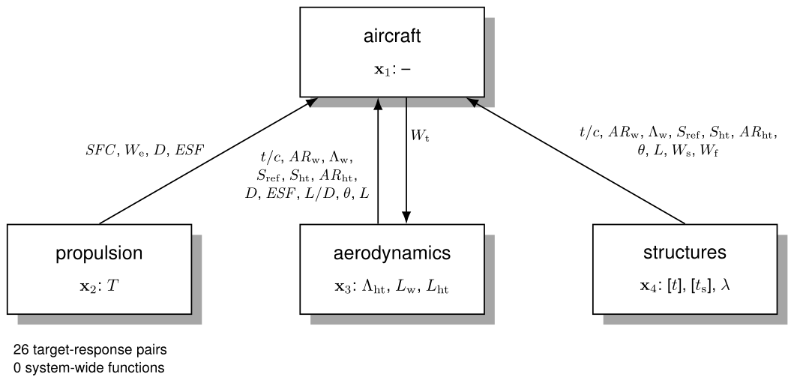
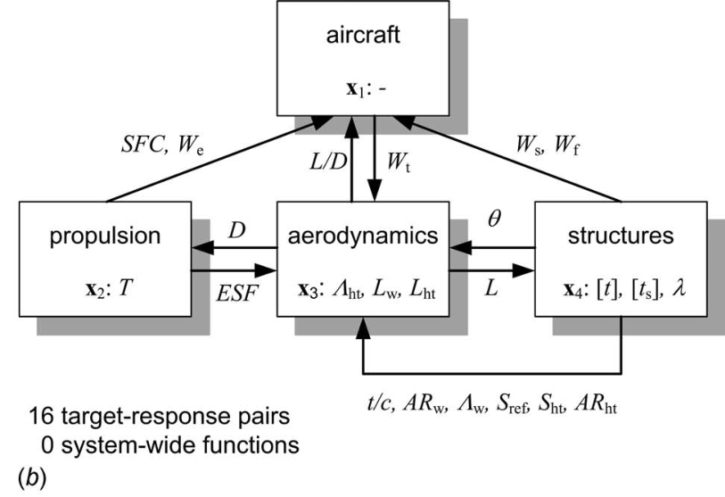
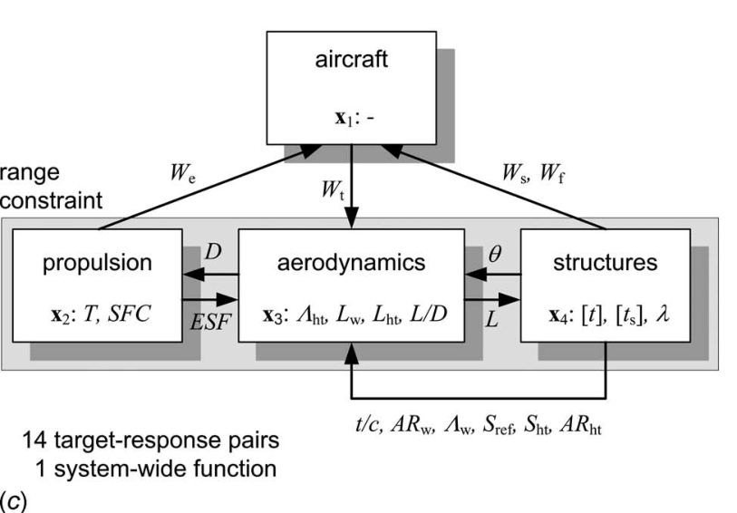
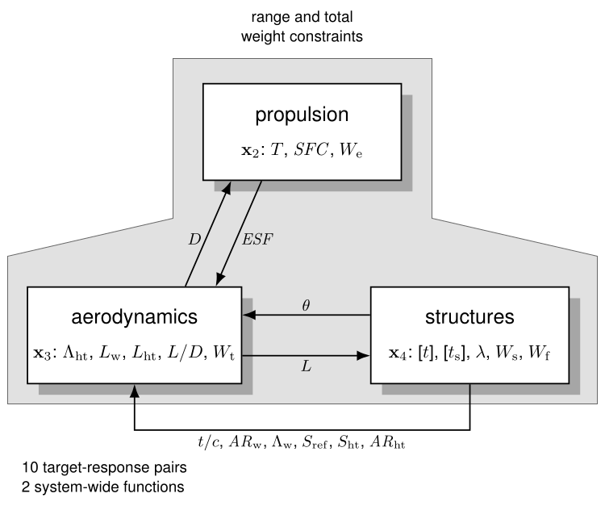

[](https://github.com/Ahmed-Bayoumy/DMDO/actions/workflows/pages/pages-build-deployment)
[](https://github.com/Ahmed-Bayoumy/DMDO/actions/workflows/lx-build-and-tests.yml)
[](https://github.com/Ahmed-Bayoumy/DMDO/actions/workflows/win-build-and-pytest.yml)
[](https://github.com/Ahmed-Bayoumy/DMDO/actions/workflows/macos-build-and-pytest.yml)


# DMDO

DMDO (Distributed Multidisciplinary Design Optimization) solves coupled, multidisciplinary engineering design
problems by decomposing them into subproblems, one per discipline, and coordinating them with nonhierarchical
analytical target cascading (NHATC).

Documentation, theory, tutorials and benchmarks: [ahmed-bayoumy.github.io/DMDO](https://ahmed-bayoumy.github.io/DMDO/)

---

**Author:** Dr. Ahmed H. Bayoumy

**Version 2612.1**

---

## Why DMDO

**Design the whole system, let every discipline keep its own tools.** Aircraft, vehicles, turbines and energy
systems are designed by teams that each own an analysis: aerodynamics, structures, propulsion, controls, cost.
Optimizing them as one monolithic problem needs a multidisciplinary analysis that converges at every design point,
one optimizer that suits every discipline, and every code in one process. DMDO needs none of that.

- **No converged multidisciplinary analysis.** Each subproblem keeps its own copies of the variables it shares with
  the others, and an augmented Lagrangian coordinator drives the copies to agreement. Coupled analyses never have
  to be iterated to convergence inside the optimizer.
- **Measured on the classic MDO benchmarks.** On the Sellar problem with derivative-free MADS subproblems, DMDO
  reaches **f = 3.2042, 0.65 % from the best known solution 3.18339** [3], with the disciplines consistent to
  **1.3 × 10⁻⁶**. In all six recorded benchmark runs (Sellar, Golinski's speed reducer, a geometric program and a
  basic two-discipline problem), the inconsistency between disciplines falls **below 10⁻³ within 6 to 16 outer
  iterations**.
- **The right optimizer for each discipline.** A subproblem built on a noisy or failing simulation uses
  derivative-free Mesh Adaptive Direct Search ([OMADS](https://github.com/Ahmed-Bayoumy/OMADS)); a smooth analytical
  one uses SciPy's SLSQP, in the same run. Any other optimizer plugs in as a small strategy class.
- **Serial, parallel or distributed, with the same answer.** Solve the subproblems one after the other
  (Gauss–Seidel) or all at once (Jacobi), in-process, in a pool of worker processes, or on remote machines. Jacobi
  results do not depend on which worker finishes first: the test suite checks that in-process, out-of-order,
  process-pool and remote runs give bit-identical designs.
- **An API, not just a script.** Build a problem from YAML, a dictionary or Python objects, then `run()` it, drive
  it one outer iteration at a time with `step()`, or solve the subproblems yourself with `ask()`/`tell()`. Observers
  stream progress, registries and entry points add solvers, executors and analyses, and an optional HTTP service
  exposes runs to any language.
- **Results you can reproduce.** Runs are seeded; every benchmark run is checked against a recorded history that
  the code must reproduce bit for bit; interrupted runs resume from their checkpoint to exactly the same result; the
  test suite runs on Linux, Windows and macOS in continuous integration.

<p align="center">
  
</p>

*Maximum inconsistency between the copies held by different subproblems, at each outer iteration of the six
recorded benchmark runs. Details in the
[benchmarking documentation](https://ahmed-bayoumy.github.io/DMDO/benchmarking.html).*

## Benchmark results

| Problem | Subproblems | Inner solver | Outer iterations | Final objective (gap) | Best known solution | Final max. inconsistency |
|---|:---:|---|:---:|---:|---:|---:|
| Sellar | 2 | OMADS MADS | 150 | **3.2042** (+0.65 %) | 3.18339 [3] | 1.3 × 10⁻⁶ |
| Sellar | 2 | OMADS poll | 150 | 3.5216 (+10.6 %) | 3.18339 [3] | 6.2 × 10⁻⁶ |
| Sellar | 2 | SciPy SLSQP | 100 | 3.6037 (+13.2 %) | 3.18339 [3] | 9.7 × 10⁻⁶ |
| Speed reducer | 4 | SciPy SLSQP | 50 | 2741.41 (−8.45 %)† | 2994.355 [3] | 7.4 × 10⁻⁴ |
| Geometric program | 3 | OMADS MADS | 100 | 20.2632 (+15.2 %) | 17.59 [4] | 1.1 × 10⁻⁷ |
| Basic problem | 2 | OMADS poll | 50 | 5.58977 (+0.18 %) | 5.58 | 3.1 × 10⁻⁷ |
| Supersonic business jet (SBJ)\* | 4 | SciPy SLSQP | 100 | Wt = 35,374 lb (+5.3 %) | 33,600 lb [5] | 4.4 × 10⁻⁵ |
| Supersonic business jet (SBJ)\* | 4 | OMADS MADS | 33–64 | Wt = 33,536 lb (−0.2 %; median of 86 runs) | 33,600 lb [5] | 8.8 × 10⁻⁹ (median of 100 runs) |

The numbers come from the recorded regression traces in `tests/golden/traces`, which the current code reproduces
bit for bit; the best known solutions are taken from the references [3]–[5] (the basic problem's, 5.58, has no
published reference), and the gap is relative to them. The Sellar rows show why DMDO lets every subproblem choose its optimizer: with the same coordination,
the full MADS algorithm ends within 0.65 % of the optimum, while the poll step alone and SLSQP settle on consistent
but less optimal designs.

† The speed-reducer run ends below the best known solution because it is not exactly consistent and feasible: its
final inconsistency is 7.4 × 10⁻⁴, and the regression suite accepts subproblem constraint violations up to 0.06 for
it.

\* The SBJ rows come from the SBJ benchmarking campaigns rather than from recorded regression traces. The aircraft,
propulsion, aerodynamics and structures subproblems (`tests/SBJ`) start from randomly perturbed designs; all
constraints are handled by the progressive barrier; the objective is the total weight Wt.

- **OMADS MADS** (100 starts, coordinator β = 1.8, γ = 0.9; 150 evaluations per solve in the aircraft, propulsion and
  aerodynamics subproblems and 500 in the structures subproblem, which holds most of the constraints; run in March
  2026 with DMDO 2601 and OMADS 2401): every run brings the inconsistency between disciplines below 10⁻³ (median
  outer iteration 13) and below 10⁻⁴ (median iteration 18), and the final inconsistency has a median of
  8.8 × 10⁻⁹. 86 runs end consistent and meeting the 2000 nm range requirement, at a median weight of 33,536 lb
  (middle half 26,600–38,800 lb); the histories of this campaign do not record the other disciplines' constraints,
  so a median slightly below the best known solution is compatible with small violations of those constraints.
- **SLSQP** (one run, β = 1.8, γ = 0.9, at most 50 iterations per solve, 100 outer iterations): the inconsistency
  falls below 10⁻³ at outer iteration 14 and below 10⁻⁴ at iteration 32; the largest remaining constraint violation
  is 3.8 × 10⁻⁴.
- With only 50 evaluations per solve (10 runs, β = 2.4, γ = 0.4, 100 outer iterations), MADS does not reach an
  inconsistency of 10⁻³ (final values 5.0 × 10⁻² to 1.0 × 10⁻¹).

On SBJ the subproblem budget decides whether the derivative-free solvers converge: the structures subproblem, with
72 constraints, needs a large budget for MADS to reach consistency.

### SBJ: the four ATC formulations of Tosserams et al. (2010)

Reference [5] decomposes the business jet in four ways (its Fig. 6, redrawn below). `tests/SBJ` contains one problem
definition per formulation, `SBJ_a.yaml` to `SBJ_d.yaml`, run with `python run_SBJ.py <a|b|c|d> [working_dir]`.
Formulations (c) and (d) relax the range constraint (and in (d) also the total weight Wt = We + Ws + Wf) as
system-wide functions instead of target-response pairs, which the problem definition declares in a
`system_functions` section.

| (a) hierarchical: 26 pairs | (b) non-hierarchical: 16 pairs |
|:---:|:---:|
|  |  |
| **(c) range as a system-wide constraint: 14 pairs + 1 function** | **(d) no aircraft subproblem: 10 pairs + 2 functions** |
|  |  |

*Figure: Four ATC formulations of the business jet. Redrawn for DMDO (TikZ sources in
`docs_src/_static/sbj/tikz`); adapted from S. Tosserams, M. Kokkolaras, L. F. P. Etman and J. E. Rooda,
J. Mech. Des. 132(5), 051002, 2010, Fig. 6 [5], https://doi.org/10.1115/1.4001346.*

**Benchmark (following the paper's Sec. 4.3).** Every formulation was solved from the same 100 starting points,
drawn uniformly within ±10 % of the reference design of the paper's Table 1. The other settings were:

- sequential (Gauss–Seidel) coordination with one inner iteration per outer iteration;
- β = 1.03, γ = 0.75, a per-coupling weight update (`normal`) and termination tolerance ε = 10⁻³;
- inconsistencies scaled by the reference values;
- initial weights from the objective estimate f̂ = 10 × 10³ lb, with w⁰ = 0.001 and α = 0.1 (coordinator options
  `w_init`, `w_init_f_hat` and `w_init_alpha`);
- SciPy SLSQP in every subproblem, in place of the paper's fmincon SQP.

Up to 50 runs ran at a time, and any run that took more than 40 minutes was stopped and counted as not converged.
The all-in-one column is an MDF solution with SLSQP from the same design-variable starts. As in the paper, the
weight and constraint statistics cover the converged runs only. The weights come from a full multidisciplinary
analysis of each final design. To reproduce: `python tests/SBJ/bm_SBJ.py --n 100 --workers 50 --timeout 2400`
(about 4 hours on a 16-core machine).

**DMDO** (same layout as the paper's Table 2):

| Formulation | | All-in-one | (a) | (b) | (c) | (d) |
|---|---|:---:|:---:|:---:|:---:|:---:|
| Coordination | | MDF | Sequential | Sequential | Sequential | Sequential |
| Converged runs | | 99/100 | 52/100§ | 99/100 | 100/100 | 100/100 |
| Optimal weight (× 10³ lb) | Min | 34.0 | 34.2 | 34.4 | 34.3 | 34.4 |
| | Mean | 36.4 | 34.7 | 35.4 | 35.4 | 35.3 |
| | Max | 38.1 | 38.3 | 38.8 | 38.3 | 38.4 |
| Maximum constraint violation | Min | 0.000 | 0.000 | 0.000 | 0.000 | 0.000 |
| | Mean | 0.000 | 0.006 | 0.001 | 0.001 | 0.001 |
| | Max | 0.000 | 0.013 | 0.008 | 0.005 | 0.004 |
| Iterations (total) | Min | – | 138 | 132 | 114 | 127 |
| | Mean | – | 155 | 159 | 143 | 148 |
| | Max | – | 182 | 199 | 180 | 173 |

**Tosserams et al. (2010), Table 2** (fmincon, MATLAB):

| Formulation | | All-in-one | (a) | (b) | (c) | (d) |
|---|---|:---:|:---:|:---:|:---:|:---:|
| Converged runs | | 100/100 | 98/100 | 100/100 | 89/100 | 94/100 |
| Optimal weight (× 10³ lb) | Min | 33.6 | 34.0 | 33.9 | 33.6 | 34.0 |
| | Mean | 34.7 | 34.9 | 35.0 | 34.3 | 34.7 |
| | Max | 38.1 | 39.2 | 48.5 | 38.8 | 46.0 |
| Maximum constraint violation | Min | 0.000 | 0.000 | 0.000 | 0.000 | 0.000 |
| | Mean | 0.000 | 0.001 | 0.002 | 0.002 | 0.003 |
| | Max | 0.001 | 0.009 | 0.009 | 0.006 | 0.006 |
| Iterations (total) | Min | – | 181 | 166 | 145 | 76 |
| | Mean | – | 244 | 209 | 202 | 85 |
| | Max | – | 283 | 261 | 242 | 131 |

§ None of the (a) runs diverged; all 48 non-converged runs were stopped at the 40-minute limit. Formulation (a) has
the most expensive subproblem (aircraft holds 15 copies and 26 pairs), so its outer iterations take about twice as
long. When stopped, those runs had reached 129–190 iterations with a median inconsistency of 2.7 × 10⁻³, and 45 of the
48 were below 5 × 10⁻³. Its iteration statistics therefore cover only the faster half of the runs. One (b) run was
also stopped at the limit.

All four formulations converge to the same two optima as the paper: the Table 1 design at about 34.3 × 10³ lb and a
heavier design at about 38 × 10³ lb (a larger wing with 9-inch bottom skin cores).

| Converged runs that end at | All-in-one | (a) | (b) | (c) | (d) |
|---|:---:|:---:|:---:|:---:|:---:|
| ≈ 34.3 × 10³ lb (below 36 × 10³ lb) | 43 | 50 | 77 | 80 | 78 |
| ≈ 38 × 10³ lb (above 37 × 10³ lb) | 56 | 2 | 22 | 20 | 21 |

The ranges of the optimal weights (34.0–38.8 × 10³ lb) and of the constraint violations (at most 0.013) match the
paper's. The formulations with fewer pairs need fewer outer iterations: (c) and (d) average 143 and 148, against
159 for (b). The paper's (d) needs far fewer iterations (85) than DMDO's (148). One possible cause is the initial
weights: the paper sets one per coupling, while DMDO uses a single weight for all couplings. Unlike the paper's (b) and (d), no DMDO run ends above
38.8 × 10³ lb.

## Features

- NHATC coordination with an augmented Lagrangian penalty and method-of-multipliers updates; penalty weights grow
  only on the couplings that stall (`normal`, `median`, `max` or `rank` update schemes)
- Three architectures selected by one `MDO.architecture` key: distributed NHATC (default), hierarchical ATC on a
  tree of subproblems, and monolithic MDF
- MDA feedback detection (strongly connected analyses, including self-references) with Gauss–Seidel, Jacobi and
  Newton MDA solvers for MDF
- Subproblem solvers: OMADS `mads`, `poll` and `search`, SciPy (`SLSQP`, `COBYLA`, `trust-constr`, ...), or your own
- Gauss–Seidel and Jacobi coordination sweeps; in-process, process-pool, remote or custom executors
- `Session` API: `run`, `step`, `ask`/`tell`, early stopping, JSON-ready results, checkpoints and exact resume
- Observers for every phase of the coordination loop; registries and entry points for solvers, executors,
  analyses and coordination policies
- Analyses as plain callables or as `Discipline` objects (`compute(inputs) -> outputs`), the natural form of an
  adapter around a simulation code or another framework's model
- Optional HTTP service (`dmdo serve`) with remote workers (`dmdo worker --tags ...`), standard library only
- Post-processing dashboard: interactive plots of any column of a run's history files

## Installation

```commandline
pip install DMDO
```

DMDO needs Python 3.10 or newer.

## Quick start

The basic two-discipline problem: minimize `u + v + a + b` where `a = log10(u) + log10(v) + log10(b)` and
`b = 1/u + 1/w + 1/a` are computed by two coupled analyses, subject to `w + b <= 10`. The problem file
[`examples/basic_problem.yaml`](examples/basic_problem.yaml) declares the variables, analyses and subproblems; the
analyses and objectives are ordinary Python callables, referenced by name.

```python
import numpy as np
from DMDO import Session

def A1(x):                       # discipline 1: x = [u, v, b] -> [a]
    x = np.maximum(x, 1e-12)
    return [np.log10(x[0]) + np.log10(x[1]) + np.log10(x[2])]

def A2(x):                       # discipline 2: x = [u, w, a] -> [b]
    x = np.maximum(x, 1e-12)
    return [1 / x[0] + 1 / x[1] + 1 / x[2]]

def opt1(x, y, c=None):          # subproblem 1: objective u + v + b + a, no constraint
    return [sum(x) + y[0], [0.0]]

def opt2(x, y, c=None):          # subproblem 2: no objective, constraint w + b - 10 <= 0
    return [0.0, [x[1] + y[0] - 10.0]]

if __name__ == "__main__":
    session = Session.from_yaml("examples/basic_problem.yaml", working_dir="runs",
                                blackboxes={"A1": A1, "A2": A2, "opt1": opt1, "opt2": opt2})
    result = session.run()
    print(result.objective, result.max_inconsistency)   # 5.589770658112853 3.051476282101007e-07
    print(result.variables)                              # u_1 = u_2 = 1.54957, a_1 = a_2 = 0.56132, ...
```

`step()` runs one outer iteration at a time; `ask()`/`tell()` hands the subproblem solves to you:

```python
from DMDO import solve_task

while not session.done:
    tasks = session.ask()                          # independent tasks: solve them anywhere, in any order
    session.tell([solve_task(t) for t in tasks])
```

## The problem definition at a glance

| Section | Purpose | Main keys |
|---|---|---|
| `variables` | One row per variable copy | `[name, subproblem, link, coupling, lb, baseline, ub, dim, type]` |
| `DA` | Disciplinary analyses | `inputs`, `outputs`, `blackbox` |
| `MDA` | Analyses evaluated in each subproblem | `analyses`, `variables`, `responses`, `solver` (MDF only) |
| `coord` | The coordinator | `beta`, `gamma`, `M_update_scheme`, `scaling`, `budget`, `index_of_master_SP` |
| `subproblem` | The subproblems | `vars`, `resps`, `opt`, `solver`, `budget`, `is_main` |
| `MDO` | The run | `architecture`, `subproblems`, `inc_stop`, `noprogress_stop`, `display` |

Every key, with its default, is listed in the
[problem-definition reference](https://ahmed-bayoumy.github.io/DMDO/user_guide/problem_definition.html).

## MDO architectures

The `architecture` key of the `MDO` block holds a path of nested keys; every option stays in the blocks that
already exist.

```yaml
MDO:
  architecture:          # default: distributed non-hierarchical ATC, exactly as before
    DIST:
      IDF: NHATC
```

| `architecture` | Method |
|---|---|
| `DIST: {IDF: NHATC}` | Non-hierarchical ATC with augmented Lagrangian coordination (default) |
| `DIST: {IDF: ATC}` | Hierarchical ATC: the subproblem with `is_main: True` is the root and the links must form a tree; the tree is solved level by level with the same ADMM coordinator |
| `MON: MDF` | Monolithic MDF: each subproblem is a standalone problem whose MDA converges its feedback loops (`MDA.<id>.solver`: `GS`, `Jacobi` or `Newton`) at every evaluation |

Any other value, such as the `architecture: IDF` of older problem files, logs one warning and runs the default.
[`examples/sellar_mdf.yaml`](examples/sellar_mdf.yaml) solves Sellar with MDF (`f = 3.183394`). See the
[architectures guide](https://ahmed-bayoumy.github.io/DMDO/user_guide/architectures.html) and how the new
architectures were [tested](https://ahmed-bayoumy.github.io/DMDO/architecture_results.html).

## Serial, parallel and remote execution

```python
session = Session.from_yaml("problem.yaml", mode="parallel", blackboxes={...})    # Jacobi in worker processes
session = Session.from_yaml("problem.yaml", sweep="jacobi", executor=my_cluster)  # any map(fn, tasks) back end
```

```commandline
dmdo serve  --host 0.0.0.0 --port 8400 --token <secret>                   # sessions over HTTP
dmdo worker --connect http://dmdo-host:8400 --tags aero --token <secret>  # where the aero code lives
```

See the tutorials on [parallel execution](https://ahmed-bayoumy.github.io/DMDO/tutorials/parallel.html) and the
[HTTP service](https://ahmed-bayoumy.github.io/DMDO/tutorials/service.html).

## Post-processing dashboard

DMDO includes a web dashboard for exploring the files a run writes. Start it and open http://127.0.0.1:8050:

```python
from DMDO import dmdo_dash

dmdo_dash()                  # or, from a terminal:  python -m DMDO.dashboard
```

Drop a run's `Coordination_history.out` (or the evaluation history `SP_<j>_<t>.out` of a subproblem solve) on the
page, then choose the columns for the X axis, the Y axis (logarithmic) and, optionally, the marker size and color.
Hover to read values, drag to zoom, and toggle the line joining the points.

<p align="center">
  
</p>

*The basic problem in the dashboard: maximum inconsistency at each outer iteration, with markers sized and colored
by the largest penalty weight `max(w)`. See the
[dashboard tutorial](https://ahmed-bayoumy.github.io/DMDO/tutorials/dashboard.html).*

## Extending DMDO and connecting other packages

DMDO talks to analyses, optimizers and execution back ends through small, framework-neutral interfaces
(`DMDO.ports`). Nothing in DMDO depends on a specific external package; an adapter written in user code only has to
satisfy the interface. OpenMDAO [1] and GEMSEO [2] are examples of frameworks whose models could be wrapped as
DMDO analyses, or which could drive DMDO through the `Session` API; neither is required by or bundled with DMDO.

```python
from DMDO import BaseSolver, SolverOutcome, register_blackbox, solvers

register_blackbox("aero", my_aero_discipline)       # usable as `blackbox: aero` in a problem file

@solvers.register("my_solver")                      # usable as `solver: my_solver`
class MySolver(BaseSolver):
    def solve(self, request):
        ...  # minimize request.objective(x) within request.lb / request.ub
        return SolverOutcome(x=x_best, fmin=f_best, hmin=h_best)
```

Plugin packages register solvers, executors, analyses and coordination policies through the `dmdo.solvers`,
`dmdo.executors`, `dmdo.blackboxes` and `dmdo.policies` entry-point groups. See the
[extension tutorial](https://ahmed-bayoumy.github.io/DMDO/tutorials/extending.html).

## Documentation

- [Getting started](https://ahmed-bayoumy.github.io/DMDO/getting_started.html)
- [Background](https://ahmed-bayoumy.github.io/DMDO/background.html): ATC, NHATC and the augmented Lagrangian
  coordinator
- [Implementation](https://ahmed-bayoumy.github.io/DMDO/implementation.html): architecture, interfaces, the
  coordination loop
- [Benchmarking](https://ahmed-bayoumy.github.io/DMDO/benchmarking.html)
- [MDO architectures](https://ahmed-bayoumy.github.io/DMDO/user_guide/architectures.html) and their
  [test results](https://ahmed-bayoumy.github.io/DMDO/architecture_results.html)
- [Tutorials](https://ahmed-bayoumy.github.io/DMDO/tutorials/index.html) and
  [API reference](https://ahmed-bayoumy.github.io/DMDO/api/index.html)

The documentation is built from `docs_src` with `pip install -r docs_src/requirements.txt` and
`sphinx-build -b html docs_src docs`.

## Citation

If DMDO contributes to published work, please cite it as follows.

```bibtex
@software{DMDO_AB,
  author    = {Bayoumy, Ahmed H.},
  title     = {DMDO: Distributed Multidisciplinary Design Optimization},
  year      = {2022},
  publisher = {GitHub},
  version   = {2612.1},
  url       = {https://github.com/Ahmed-Bayoumy/DMDO},
  doi       = {https://doi.org/10.5281/zenodo.24281878}
}
```

## License & copyright

© Ahmed H. Bayoumy

This project is licensed under the GNU General Public License v3.0 or later (GPL-3.0-or-later). See the LICENSE file
for details.

## Benchmark references

3. N. P. Tedford and J. R. R. A. Martins, "Benchmarking multidisciplinary design optimization algorithms",
   *Optimization and Engineering*, 11(1), 159–183, 2010. https://doi.org/10.1007/s11081-009-9082-6 (Sellar: Sect.
   5.1; speed reducer: Sect. 5.2)
4. B. Talgorn, M. Kokkolaras, A. DeBlois and P. Piperni, "Numerical investigation of non-hierarchical coordination
   for distributed multidisciplinary design optimization with fixed computational budget", *Structural and
   Multidisciplinary Optimization*, 55(1), 205–220, 2017. https://doi.org/10.1007/s00158-016-1489-z (geometric
   programming: Table 1)
5. S. Tosserams, M. Kokkolaras, L. F. P. Etman and J. E. Rooda, "A nonhierarchical formulation of analytical target
   cascading", *Journal of Mechanical Design*, 132(5), 051002, 2010. https://doi.org/10.1115/1.4001346 (supersonic
   business jet: Table 2, lowest all-in-one optimal weight over 100 starting points)

## References to related frameworks

DMDO is independent of the frameworks below; they are cited only as examples of tools that can be connected to it
through its generic interfaces.

1. J. S. Gray, J. T. Hwang, J. R. R. A. Martins, K. T. Moore and B. A. Naylor, "OpenMDAO: an open-source framework
   for multidisciplinary design, analysis, and optimization", *Structural and Multidisciplinary Optimization*, 59(4),
   1075–1104, 2019. https://doi.org/10.1007/s00158-019-02211-z — https://openmdao.org
2. F. Gallard, C. Vanaret, D. Guénot, V. Gachelin, R. Lafage, B. Pauwels, P.-J. Barjhoux and A. Gazaix, "GEMS: a
   Python library for automation of multidisciplinary design optimization process generation", *AIAA SciTech Forum,
   2018 AIAA/ASCE/AHS/ASC Structures, Structural Dynamics, and Materials Conference*, AIAA 2018-0657.
   https://doi.org/10.2514/6.2018-0657 — https://gemseo.org
