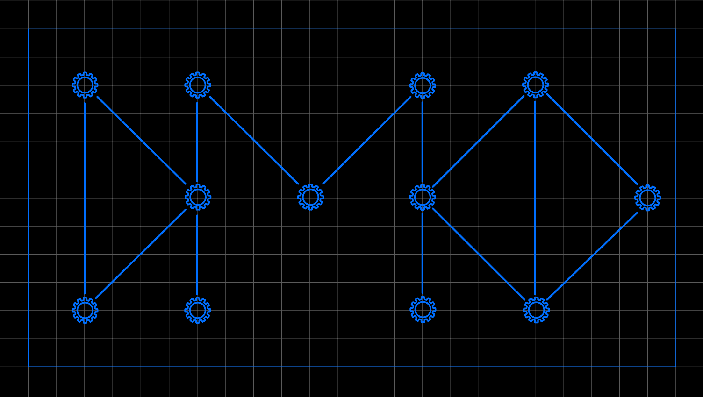

[](https://github.com/Ahmed-Bayoumy/DNDO/actions/workflows/pages/pages-build-deployment)
[](https://github.com/Ahmed-Bayoumy/DMDO/actions/workflows/lx-build-and-tests.yml)
[](https://github.com/Ahmed-Bayoumy/DMDO/actions/workflows/win-build-and-pytest.yml)
[](https://github.com/Ahmed-Bayoumy/DMDO/actions/workflows/macos-build-and-pytest.yml)



# DMDO

DMDO is a python implementation for the distributed multidisciplinary design optimization method called nonhierarchical analytical target cascading (NHATC)

For technical and code documentation, please visit [DMDO Webpage](https://ahmed-bayoumy.github.io/DMDO/).

---

**Version 2604.0**

---

## License & copyright

© Ahmed H. Bayoumy 

This project is licensed under the GNU General Public License v3.0 or later (GPL-3.0-or-later).

See the LICENSE file for details.

---

## Citation

If you use this code, please cite it as shown below.

```pycon
   @software{DMDO_AB,
   author       = {Bayoumy, A.},
   title        = {DMDO},
   year         = 2022,
   publisher    = {Github},
   version      = {1.3.0},
   url          = {https://github.com/Ahmed-Bayoumy/DMDO}
   }
```

## How to use DMDO package

After installing the `DMDO` package using the `pip` command, the functions and classes of `DMDO` module can be imported directly to the python script as follows:

```pycon
from DMDO import *
```

## Extending DMDO and connecting other packages

DMDO talks to analyses and optimizers through small, framework-neutral interfaces (`DMDO.ports`). Nothing in DMDO
depends on a specific external package; an adapter only has to satisfy the interface.

**Disciplines.** Any object with a `compute(inputs: dict) -> dict` method (inputs and outputs keyed by variable name)
can be used wherever a blackbox callable is accepted, e.g. a wrapper around an OpenMDAO `Problem` or a GEMSEO
discipline:

```python
class MyDiscipline:
    def compute(self, inputs):
        return {"y1": inputs["x1"] ** 2}
```

**Naming blackboxes from YAML.** `blackbox:` / `opt:` names in a problem definition are resolved, in order, from the
`blackboxes` mapping passed to `main`, from the global registry, or as an import path:

```python
from DMDO import main, register_blackbox
register_blackbox("A1", my_analysis)                      # global registry
main({"setup_file": "problem.yaml", "mdo_name": "run", "working_dir": ".",
      "blackboxes": {"opt1": my_objective}})              # per-run mapping
# YAML: blackbox: "my_package.analyses:aero"             # import path
```

**Subproblem solvers.** Built-in strategies are `mads` (alias `OMADS`), `poll`, `search` and `scipy`. A new solver
subclasses `DMDO.BaseSolver`, implements `solve(request: SolverRequest) -> SolverOutcome`, and is registered either
in code or as a plugin through the `dmdo.solvers` entry-point group:

```python
from DMDO import BaseSolver, SolverOutcome, solvers

@solvers.register("my_solver")
class MySolver(BaseSolver):
    def solve(self, request):
        ...  # minimise request.objective(x) within request.lb/request.ub
        return SolverOutcome(x=x_best, fmin=f_best, hmin=h_best)
```

```toml
# pyproject.toml of a plugin package
[project.entry-points."dmdo.solvers"]
my_solver = "my_pkg.solvers:MySolver"
```

**Serial and parallel execution.** Two choices are independent of each other:

- the *sweep* decides what each subproblem sees within an outer iteration: `gauss_seidel` (each solve uses the
  targets updated by the previous ones) or `jacobi` (all solves start from the same snapshot; results are merged in
  subproblem order, so the outcome does not depend on which worker finishes first);
- the *executor* decides where the solves run: `inprocess`, `process` (a pool of worker processes), or any object with
  `map(fn, tasks)` / `close()` — e.g. a client for remote workers or a cluster.

```python
MDAO.run(file, mode="serial")                         # Gauss-Seidel, in this process (default)
MDAO.run(file, mode="parallel")                       # Jacobi, one worker process per subproblem
MDAO.run(file, sweep="jacobi", executor=my_cluster)   # Jacobi on remote workers
```

Each solve is shipped as a `SubproblemTask` and solved by the module-level `DMDO.solve_task`, so a remote worker only
needs DMDO and the problem's blackboxes installed. Executors can also be registered by name
(`DMDO.executors.register`) or through the `dmdo.executors` entry-point group.

## How to run DMDO from terminal
After installing the libraries listed in the `requirements.txt`, `DMDO/DMDO.py` can be called directly from a 
terminal window under the src directory. The path of the JSON template, which contains the problem input parameters, should be entered as an input argument to the `DMDO.py` call. 

```commandline
python ./src/DMDO/DMDO.py ./tests/test_files/Basic_MDO.yaml
```

The generated `Coordination_history.out` file now includes two AI spike-tracking columns when the AI regularizer is enabled:

- `alarm_detected`: the raw detector alarm for the current update
- `spike_detected`: the stricter expected-spike flag returned by the coordinator helper after decisor and non-improvement gating


