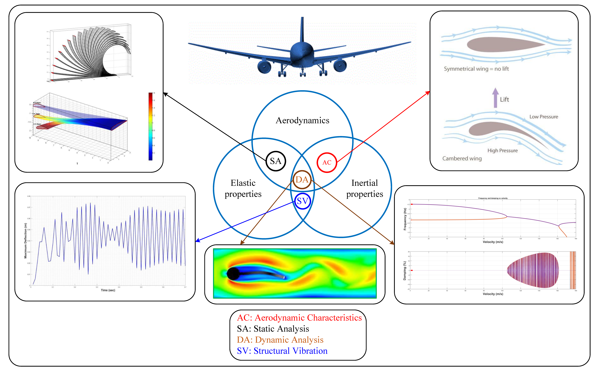
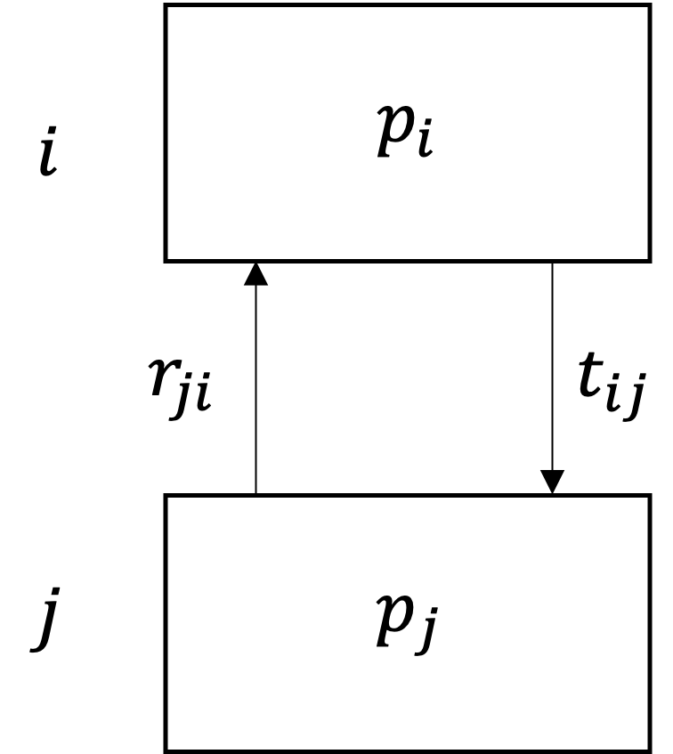
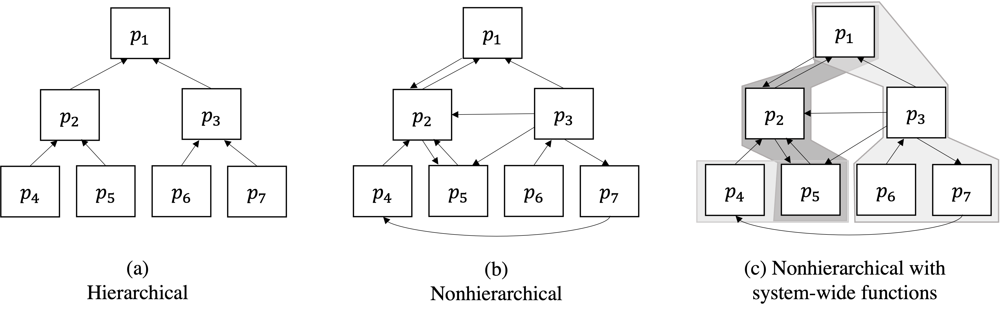
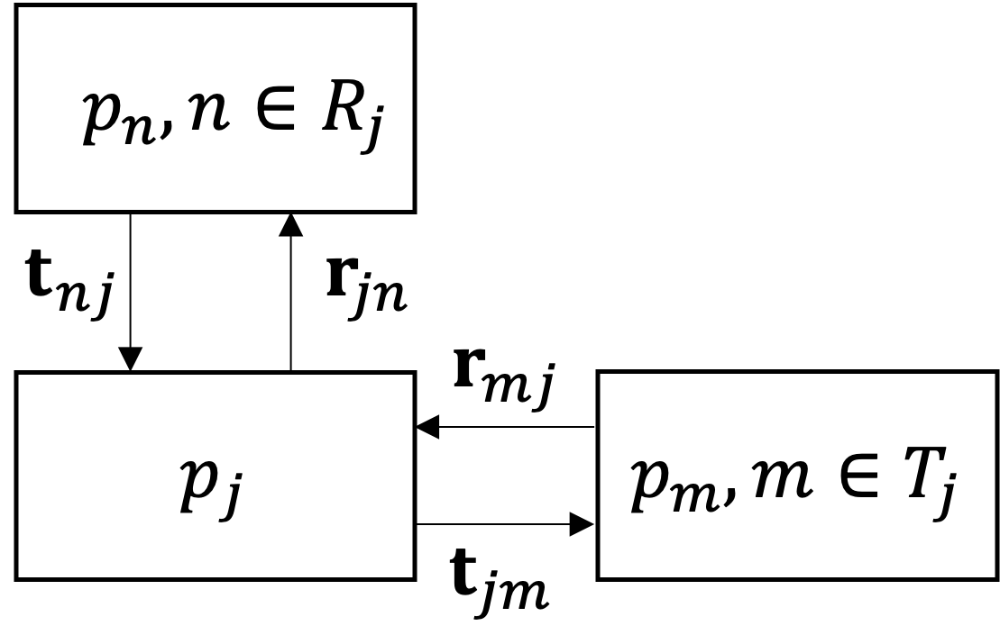
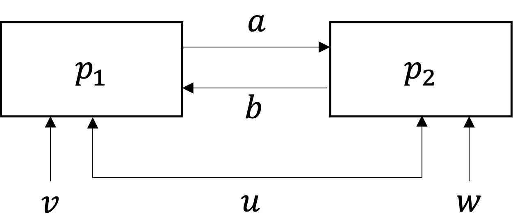

Background
##########

Engineering systems are often decomposable: an aircraft is designed by aerodynamics, structures, propulsion and
performance teams, each with its own analysis codes and expertise. Optimizing the system as a whole requires
accounting for the interactions between these disciplines (:numref:`F-mdo`) while letting each of them work with its
own models, tools and design freedom. Distributed multidisciplinary design optimization (MDO) does this by
decomposing the system design problem into subproblems, one per discipline or component, and coordinating their
solutions so that the subproblem designs agree and are optimal for the system.

.. _F-mdo:

   Interactions between the disciplines of a multidisciplinary system.

Architectures for MDO
=====================

MDO architectures are commonly divided into monolithic and distributed ones :cite:p:`martins2013multidisciplinary`.
Monolithic architectures solve a single optimization problem: the multidisciplinary feasible (MDF) architecture
converges a multidisciplinary analysis (MDA) at every design point, and the individual discipline feasible (IDF)
architecture adds the coupling variables to the optimization and enforces their consistency as equality constraints.
Distributed architectures split the problem into subproblems that are solved separately and coordinated. Coordination
methods include penalty-based decomposition :cite:p:`demiguel2006local,demiguel2008decomposition`, bilevel integrated
system synthesis :cite:p:`sobieszczanski2000bilevel,sobieszczanski2003bilevel`, collaborative optimization
:cite:p:`braun1996collaborative,braun1997collaborative,lin2004analysis,roth2008enhanced`, quasi-separable decomposition
:cite:p:`haftka2005multidisciplinary`, and augmented Lagrangian coordination with the alternating direction method of
multipliers (ADMM) :cite:p:`tosserams2007augmented,tosserams2008augmented,tosserams2009block`.

DMDO implements **analytical target cascading (ATC)** in its nonhierarchical form (NHATC). According to the
classification of :cite:t:`tosserams2009classification`, ATC is an alternating method with closed design constraints
and open consistency constraints: every subproblem satisfies its own constraints at every iteration, while the
consistency between subproblems is reached only at convergence of the coordination.

When to use DMDO
================

Solving one large MDO problem all-in-one works well when the MDA converges reliably and a single optimizer suits
every discipline. A distributed approach such as DMDO is preferable when one or more of the following holds:

* the MDA does not converge, or converges only slowly, for example because the disciplines are tightly coupled;
* the disciplines are developed by different teams, with different codes or on different machines, and should keep
  their autonomy;
* different disciplines call for different optimizers: derivative-free search for noisy or non-smooth simulations,
  gradient-based methods for smooth analytical models;
* the all-in-one design space is too large for the optimizer that would have to handle it;
* subproblems can be solved in parallel, which a single sequential optimization cannot exploit.

Analytical target cascading
===========================

ATC was introduced to translate system-level design targets into design specifications for the subsystems
(components) that make up the system :cite:p:`michelena1999system,kim2003target`. Targets are cascaded through a
hierarchical decomposition: a subproblem sets targets for its children and computes responses to the targets it
receives from its parent (:numref:`F-tr`). Each subproblem minimizes the deviations between its target-response
pairs while satisfying its local design constraints :cite:p:`tosserams2010nonhierarchical`.

.. _F-tr:

   Target-response coupling between a parent subproblem :math:`p_{i}` and its child :math:`p_{j}`.

.. prf:definition:: Targets and responses
   :label: def-targets

   Let the subproblem :math:`p_{ij}` at level :math:`i` be the parent of the subproblems
   :math:`p_{(i+1)k},\ k \in \mathcal{C}_{ij}`. The design targets :math:`\mathbf{t}_{(i+1)k}` are computed by
   :math:`p_{ij}` and sent to its children; in turn, the children compute responses :math:`\mathbf{r}_{(i+1)k}` and
   return them to :math:`p_{ij}`.

Responses of higher-level components depend on responses of lower-level components, and ATC minimizes the gap
between what higher levels require and what lower levels can achieve. With the consistency constraints
:math:`\mathbf{c}_{ij} = \mathbf{t}_{ij} - \mathbf{r}_{ij} = \mathbf{0}` relaxed by a penalty function :math:`\phi`,
the hierarchical ATC subproblem reads

.. math::
   :label: eq-atc

   \begin{array}{ll}
   \min_{\bar{\mathbf{x}}_{ij}} & f_{ij}(\bar{\mathbf{x}}_{ij}) + \phi(\mathbf{t}_{ij}-\mathbf{r}_{ij})
       + \sum_{k \in \mathcal{C}_{ij}} \phi(\mathbf{t}_{(i+1)k}-\mathbf{r}_{(i+1)k}) \\[4pt]
   \text{s.t.} & \mathbf{g}_{ij}(\bar{\mathbf{x}}_{ij}) \le \mathbf{0}, \qquad
                 \mathbf{h}_{ij}(\bar{\mathbf{x}}_{ij}) = \mathbf{0}, \\[2pt]
   \text{with} & \mathbf{r}_{ij} = \mathbf{a}_{ij}(\mathbf{x}_{ij}, \mathbf{t}_{(i+1)k_1}, \dots,
                 \mathbf{t}_{(i+1)k_{c_{ij}}}), \qquad
                 \bar{\mathbf{x}}_{ij} = [\mathbf{x}_{ij}, \mathbf{r}_{ij}, \mathbf{t}_{(i+1)k_1}, \dots,
                 \mathbf{t}_{(i+1)k_{c_{ij}}}],
   \end{array}

where :math:`\mathbf{x}_{ij}` are the local design variables, :math:`f_{ij}` the local objective,
:math:`\mathbf{g}_{ij}` and :math:`\mathbf{h}_{ij}` the local constraints and :math:`\mathbf{a}_{ij}` the analyses
that compute the responses. A local objective and local constraints are not required by the ATC process.

The hierarchical formulation allows negotiation only between parents and children. Many MDO problems have no such
hierarchy: their analyses exchange data in loops, and system-wide quantities such as mass, cost or power depend on
the variables of several subproblems (:numref:`F-fd`). Coordinating them with hierarchical ATC requires at least as
many artificial target-response pairs as there are subproblems.

.. _F-fd:

   Functional dependence of the hierarchical and nonhierarchical formulations. Arrows show the flow of responses;
   shaded boxes show system-wide functions that depend on the variables of several subproblems.

Nonhierarchical ATC
===================

NHATC :cite:p:`tosserams2010nonhierarchical` lets any subproblem send targets to, and receive targets from, any other
subproblem, its *neighbors*. The level index is dropped and the two indices of a quantity denote the sender and the
receiver.

.. prf:definition:: Neighbors
   :label: def-neighbors

   Let :math:`\mathcal{T}_{j}` be the set of neighbors for which subproblem :math:`j` sets targets, and
   :math:`\mathcal{R}_{j} = \{ n : j \in \mathcal{T}_{n} \}` the set of neighbors from which it receives targets,
   that is, for which it computes responses. :math:`\mathbf{t}_{nj}` are the targets that :math:`j` receives from
   :math:`n`, and :math:`\mathbf{r}_{jn}` the responses that :math:`j` computes to match them.

.. _F-neighbors:

   Nonhierarchical target and response flow between subproblem :math:`j` and its neighbors.

Subproblem :math:`j` has two sets of consistency constraints, :math:`\mathbf{c}_{nj} = \mathbf{t}_{nj} -
\mathbf{r}_{jn} = \mathbf{0}` for :math:`n \in \mathcal{R}_{j}`, and :math:`\mathbf{c}_{jm} = \mathbf{t}_{jm} -
\mathbf{r}_{mj} = \mathbf{0}` for :math:`m \in \mathcal{T}_{j}`. The NHATC subproblem is

.. math::
   :label: eq-nhatc

   \begin{array}{ll}
   \min_{\bar{\mathbf{x}}_{j}} & f_{j}(\bar{\mathbf{x}}_{j})
       + \sum_{n \in \mathcal{R}_{j}} \phi(\mathbf{t}_{nj}-\mathbf{r}_{jn})
       + \sum_{m \in \mathcal{T}_{j}} \phi(\mathbf{t}_{jm}-\mathbf{r}_{mj}) \\[4pt]
   \text{s.t.} & \mathbf{g}_{j}(\bar{\mathbf{x}}_{j}) \le \mathbf{0}, \qquad
                 \mathbf{h}_{j}(\bar{\mathbf{x}}_{j}) = \mathbf{0}, \\[2pt]
   \text{with} & \mathbf{r}_{jn} = \mathbf{S}_{jn}\,\mathbf{a}_{j}(\mathbf{x}_{j}, \mathbf{t}_{jm} \mid
                 m \in \mathcal{T}_{j}),\ n \in \mathcal{R}_{j}, \\[2pt]
               & \bar{\mathbf{x}}_{j} = [\mathbf{x}_{j},\ \mathbf{r}_{jn} \mid n \in \mathcal{R}_{j},\
                 \mathbf{t}_{jm} \mid m \in \mathcal{T}_{j}],
   \end{array}

where :math:`\mathbf{S}_{jn}` selects the components of the analysis outputs that are sent to neighbor :math:`n`.

In DMDO terms, every shared or coupling quantity has one **copy** per subproblem that uses it (a row of the
``variables`` table, see :doc:`getting_started`), and each pair of linked copies forms a target-response pair.

Augmented Lagrangian coordination
=================================

Inconsistencies
---------------

The links between copies are collected in a linker matrix whose columns pair the index of a copy with the index of
the copy it is linked to (:numref:`A-linker`). For every link :math:`l` between copies :math:`i` and :math:`j`, the
scaled inconsistency is

.. math::
   :label: eq-q

   q_{l} = \bar{\sigma}_{l}\,(x_{i} - x_{j}), \qquad \bar{\sigma}_{l} = \tfrac{1}{2}(\sigma_{i} + \sigma_{j}),

with one entry per component for vector-valued variables, and :math:`q_{l} \in \{0, 1\}` (equal or not) for
categorical ones. By default the scale factors are :math:`\sigma_{i} = 0.1 / (u_{i} - \ell_{i})`, from the bounds of
each copy, so that couplings of very different magnitudes weigh comparably; a single constant can be given instead.
The inconsistencies of all links form the vector :math:`\mathbf{q} \in \mathbb{R}^{n_q}`.

.. _A-linker:
.. pcode::
   :linenos:

    \begin{algorithm}
    \caption{Linker matrix of subproblem $i$}
    \begin{algorithmic}
    \STATE{Given the copies $\mathbf{x}$, their subproblems $\mathbf{D}$, links $\mathbf{L}$, coupling types $\mathbf{C}$ and names $\mathbf{N}$}
    \PROCEDURE{Build-linker-matrix}{}
        \STATE{$\bar{\mathbf{l}} \gets \{\}$, $\underline{\mathbf{l}} \gets \{\}$}
        \FOR{$k \gets 1$ \textbf{to} $n_{\mathbf{x}}$}
          \IF{($\mathbf{D}[k] = i$ \textbf{or} $\mathbf{C}[k] \neq$ uncoupled) \textbf{and} $\mathbf{L}[k]$ is set \textbf{and} $k \notin \underline{\mathbf{l}}$}
            \FOR{$r \gets 1$ \textbf{to} $n_{\mathbf{x}}$}
              \IF{$\mathbf{D}[r] = \mathbf{L}[k]$ \textbf{and} $\mathbf{N}[r] = \mathbf{N}[k]$}
                \STATE{append $k$ to $\bar{\mathbf{l}}$ and $r$ to $\underline{\mathbf{l}}$}
              \ENDIF
            \ENDFOR
          \ENDIF
        \ENDFOR
        \RETURN{$[\bar{\mathbf{l}};\ \underline{\mathbf{l}}]$}
    \ENDPROCEDURE
    \end{algorithmic}
    \end{algorithm}

Penalty function
----------------

The consistency constraints :math:`\mathbf{q} = \mathbf{0}` are relaxed with the augmented Lagrangian penalty

.. math::
   :label: eq-phi

   \phi(\mathbf{q}) = \mathbf{v}^{\mathsf T}\mathbf{q} + \|\mathbf{w}\circ\mathbf{q}\|_{2}^{2},

where :math:`\mathbf{v}` are the Lagrange multiplier estimates, :math:`\mathbf{w}` the penalty weights and
:math:`\circ` the entrywise (Hadamard) product. When subproblem :math:`j` is solved, the penalty is summed over the
links that involve its copies, and the subproblem minimizes

.. math::
   :label: eq-sp

   f_{j}(\bar{\mathbf{x}}_{j}) + \sum_{l \in \mathcal{L}_{j}} \left( v_{l}\, q_{l} + w_{l}^{2}\, q_{l}^{2} \right)

subject to its local constraints, with the copies held by the other subproblems fixed at their latest values. The
subproblem that holds the system objective is the **master** subproblem; the others usually have no local objective.

Method of multipliers
---------------------

The coordinator updates the penalty parameters after each outer iteration :math:`t`, following the method of
multipliers :cite:p:`bertsekas1982constrained`:

.. math::
   :label: eq-v

   \mathbf{v}^{t+1} = \mathbf{v}^{t} + 2\,\mathbf{w}^{t}\circ\mathbf{w}^{t}\circ\mathbf{q}^{t},

and grows the penalty weights of the links that do not make enough progress:

.. math::
   :label: eq-w

   w^{t+1}_{l} =
   \begin{cases}
     w^{t}_{l} & \text{if } |q^{t}_{l}| \le \gamma\, |q^{t-1}_{l}|, \\
     \beta^{\,e_{l}}\, w^{t}_{l} & \text{otherwise,}
   \end{cases}
   \qquad \beta > 1,\ 0 \le \gamma < 1,

where :math:`q^{t-1}` are the inconsistencies at the start of the outer iteration and the exponent :math:`e_{l}`
depends on the **update scheme** (``M_update_scheme``). Starting values are :math:`\mathbf{v}^{0} = \mathbf{0}` and
:math:`\mathbf{w}^{0} = \mathbf{1}`.

.. list-table:: Penalty-weight update schemes (``M_update_scheme``)
   :header-rows: 1
   :widths: 18 82

   * - Scheme
     - Exponent :math:`e_{l}` for a stalled link :math:`l`
   * - ``normal``
     - :math:`1`: every stalled link grows by :math:`\beta`.
   * - ``median``
     - :math:`\kappa` if :math:`|q_{l}| \ge \operatorname{median}(|\mathbf{q}|)`, else :math:`0`: only the stalled
       links with above-median inconsistency grow (:math:`\kappa = 2` by default).
   * - ``max``
     - :math:`n_{q}` for the stalled link(s) with the largest inconsistency, else :math:`0`.
   * - ``rank``
     - :math:`2\,\rho_{l} / \max_{k} \rho_{k}`, where :math:`\rho_{l}` is the rank of :math:`q_{l}`: larger
       inconsistencies grow faster.

Growing the weights only where consistency stalls keeps the penalty small on couplings that converge on their own,
which preserves the conditioning of the subproblems; the multipliers :math:`\mathbf{v}` let the coordination reach
consistency without driving the weights to infinity :cite:p:`tosserams2008augmented,boyd2011distributed`.

The coordination loop
=====================

One **outer iteration** solves every subproblem once (the *inner loop*) and then updates the coordinator. Two sweep
orders are available:

Gauss–Seidel
   Subproblems are solved one after the other. Each one starts from the copies updated by the previous solves of the
   same outer iteration, which usually reduces the number of outer iterations.
Jacobi
   All subproblems start from the same snapshot of the coordinator, in which the copies of each linked group are
   first set to their mean. Each subproblem then evaluates its penalty on the inconsistency shifted by
   :math:`\delta_{l} = -v_{l}/(2w_{l}^{2}) - \bar{q}_{l}`, where :math:`\bar{q}_{l}` is the inconsistency of the
   averaged snapshot; this is the scaled form of the augmented Lagrangian used by consensus ADMM
   :cite:p:`boyd2011distributed`. The subproblems can be solved concurrently; their results are then merged in
   subproblem order, each subproblem contributing the copies it owns, so the outcome does not depend on the order in
   which the solves finish.

.. _A-nhatc:
.. pcode::
   :linenos:

    \begin{algorithm}
    \caption{NHATC coordination as implemented in DMDO}
    \begin{algorithmic}
    \STATE{Given the subproblems $p_1, \dots, p_M$, the copies $\mathbf{x}^{0}$, $\beta$, $\gamma$, the stopping tolerance $\varepsilon$ and the budget $T$}
    \PROCEDURE{Initialization}{}
        \STATE{build the linker matrix (Algorithm 1) and the scale factors $\boldsymbol{\sigma}$}
        \STATE{$\mathbf{v} \gets \mathbf{0}$, $\mathbf{w} \gets \mathbf{1}$, $t \gets 0$}
    \ENDPROCEDURE
    \PROCEDURE{Inner-loop}{}
        \FOR{$j \gets 1$ \textbf{to} $M$}
            \STATE{take the targets of $p_j$ from the latest copies (Gauss--Seidel) or from the common snapshot (Jacobi)}
            \STATE{solve $\min f_j + \sum_{l \in \mathcal{L}_j} \phi(q_l)$ subject to the local constraints of $p_j$ with its inner solver}
            \STATE{write the copies owned by $p_j$ back to the coordinator}
        \ENDFOR
    \ENDPROCEDURE
    \PROCEDURE{Coordination-loop}{}
        \WHILE{$t < T$}
              \STATE{\textsc{Inner-loop}}
              \STATE{compute the inconsistencies $\mathbf{q}^{t}$ (Eq. q)}
              \STATE{update $\mathbf{v}$ and $\mathbf{w}$ (Eqs. v and w)}
              \IF{$\|\mathbf{q}^{t}\|_{\infty} < \varepsilon$ \textbf{and} $\|\,|\mathbf{q}^{t}| - |\mathbf{q}^{t-1}|\,\|_{\infty} < \varepsilon$}
                  \STATE{stop: the copies agree}
              \ENDIF
              \STATE{$t \gets t + 1$}
        \ENDWHILE
    \ENDPROCEDURE
    \end{algorithmic}
    \end{algorithm}

The run stops when the maximum inconsistency is below ``inc_stop`` and no longer changes, when the maximum
inconsistency has not improved for ``noprogress_stop`` outer iterations, or when the outer-iteration budget is
exhausted.

.. note::

   In the default configuration DMDO applies the multiplier update :eq:`eq-v`–:eq:`eq-w` twice per outer iteration:
   once right after the inner loop and once after the iteration has been recorded. Both updates use the
   inconsistencies of the same inner loop, so a stalled link can grow by up to :math:`\beta^{2e_{l}}` per outer
   iteration. The benchmark results in :doc:`benchmarking` were obtained with this behavior.

Example: the basic problem
==========================

The basic problem of :doc:`getting_started`,

.. math::

   \begin{array}{ll}
   \min_{u,v,w} & u + v + a + b \\[2pt]
   \text{s.t.}  & a = \log_{10} u + \log_{10} v + \log_{10} b, \qquad
                  b = u^{-1} + w^{-1} + a^{-1}, \\
                & w + b - 10 \le 0, \qquad 0 \le u, v, w, a, b \le 10,
   \end{array}

has the workflow of :numref:`F-basic` and is partitioned into two subproblems that each keep copies of
:math:`u`, :math:`a` and :math:`b`:

.. _F-basic:

   Workflow of the basic problem.

.. math::

   (p_1)\quad
   \begin{array}{ll}
   \min_{u_1, v, b_1} & u_{1} + v + a_{1} + b_{1} + \phi_{u}(u_{1}-u_{2}) + \phi_{a}(a_{1}-a_{2})
                        + \phi_{b}(b_{1}-b_{2}) \\[2pt]
   \text{with} & a_{1} = \log_{10} u_{1} + \log_{10} v + \log_{10} b_{1}, \qquad 0 \le u_{1}, v, a_{1}, b_{1} \le 10,
   \end{array}

.. math::

   (p_2)\quad
   \begin{array}{ll}
   \min_{u_2, w, a_2} & \phi_{u}(u_{1}-u_{2}) + \phi_{a}(a_{1}-a_{2}) + \phi_{b}(b_{1}-b_{2}) \\[2pt]
   \text{s.t.} & w + b_{2} - 10 \le 0, \\[2pt]
   \text{with} & b_{2} = u_{2}^{-1} + w^{-1} + a_{2}^{-1}, \qquad 0 \le u_{2}, w, a_{2}, b_{2} \le 10.
   \end{array}

Subproblem 1 holds the system objective (it is the master subproblem). Subproblem 2 has no local objective: it only
tries to match the targets of subproblem 1 while satisfying its constraint. As the penalty weights grow on the links
that stall, the copies are pushed together and the two subproblems converge to a consistent design.
