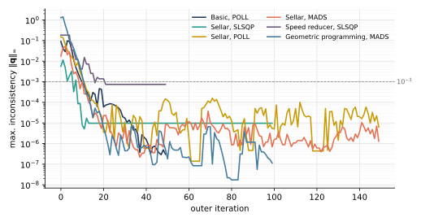
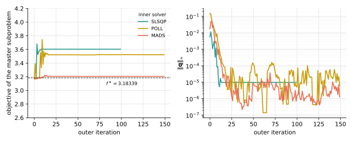
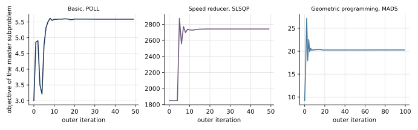

Benchmarking
############

This chapter reports how DMDO performs on the classic test problems of distributed MDO, and how the results are
kept reproducible.

Where the numbers come from
===========================

Every result below, except those of the supersonic business jet (see `Supersonic business jet`_), comes from the
**recorded regression traces** in ``tests/golden/traces``. Each trace is the
complete history of one run (the objective of the master subproblem and the maximum inconsistency at every outer
iteration, the final multipliers, penalty weights and design), recorded with fixed seeds on Windows with Python 3.12.
The test suite runs the same problems again and requires the current code to reproduce every trace **bit for bit**,
so the figures and tables of this chapter describe what the released code computes. They are regenerated from the
traces, without running any optimization, by:

.. code-block:: console

   $ python docs_src/scripts/plot_benchmarks.py

Test problems
=============

.. list-table:: Problems and settings of the recorded runs
   :header-rows: 1
   :widths: 22 9 9 24 14 22

   * - Run
     - SPs
     - Copies
     - Coordinator (:math:`\beta`, :math:`\gamma`, scheme)
     - Outer budget
     - Inner solver (budget)
   * - Basic problem
     - 2
     - 8
     - 1.3, 0.5, ``normal``
     - 50
     - OMADS ``poll`` (150)
   * - Sellar :cite:p:`sellar1996response`
     - 2
     - 9
     - 2.0, 0.5, ``median``
     - 100
     - SciPy SLSQP (150)
   * - Sellar
     - 2
     - 9
     - 1.3, 0.2, ``median``
     - 150
     - OMADS ``poll`` (500)
   * - Sellar
     - 2
     - 9
     - 1.3, 0.2, ``median``
     - 150
     - OMADS ``mads`` (500)
   * - Speed reducer :cite:p:`golinski1970optimal`
     - 4
     - 20
     - 1.3, 0.5, ``median``
     - 50
     - SciPy SLSQP (150)
   * - Geometric programming
     - 3
     - 17
     - 1.3, 0.2, ``median``
     - 100
     - OMADS ``mads`` (500 / 150 / 150)

*SPs* is the number of subproblems and *Copies* the number of variable copies (rows of the ``variables`` table). The
problem statements and their partitions are given in :doc:`tutorials/sellar` and in the test module
``tests/test_basic.py``. Every run uses its full outer budget (no early stop).

Results
=======

.. csv-table:: Final results of the recorded runs
   :file: _static/bench_summary.csv
   :header: "Run", "SPs", "Inner solver", "Outer iterations", "Final objective", "Best known solution", "Gap", "Final max. inconsistency", "First iteration with max. inconsistency < 1e-3"
   :widths: 20 6 12 9 11 10 8 12 12

Best known solutions: Sellar and speed reducer from :cite:t:`tedford2010benchmarking` (Sects. 5.1 and 5.2), geometric
programming from :cite:t:`talgorn2017numerical` (Table 1); none is published for the basic problem. The gap is
relative to the best known solution.

.. _F-bench-consistency:

   Maximum inconsistency between the copies of the disciplines at each outer iteration.

**Consistency.** In every run the coordinator brings the copies held by different subproblems into agreement
quickly: the maximum inconsistency falls below :math:`10^{-3}` within 6 to 16 outer iterations
(:numref:`F-bench-consistency`). Five of the six runs end between :math:`1.1\times10^{-7}` and
:math:`9.7\times10^{-6}`; the speed reducer, which has the most copies (20 across 4 subproblems) and the shortest
budget (50 iterations), ends at :math:`7.4\times10^{-4}`.

Sellar: the choice of inner solver
----------------------------------

.. _F-bench-sellar:

   Sellar problem with three inner solvers: objective of the master subproblem (left) and maximum inconsistency
   (right). The dashed line is the best known solution :math:`f^\ast = 3.18339`.

The Sellar problem has a known optimum, :math:`f^\ast = 3.18339` at :math:`(z_1, x_1, x_2) = (1.9776, 0, 0)`
:cite:p:`tedford2010benchmarking`, which makes it a direct test of the coordination.
With derivative-free **MADS** subproblems, DMDO ends at :math:`f = 3.2042`, **0.65 % above the optimum**, with the
disciplines consistent to :math:`1.3\times10^{-6}`. With the **poll** step alone and with **SLSQP**, the coordination
also reaches consistency (:math:`6.2\times10^{-6}` and :math:`9.7\times10^{-6}`) but settles on designs 10.6 % and
13.2 % above the optimum.

In :numref:`F-bench-sellar`, the SLSQP objective stays within 0.5 % of its final value from the sixth outer
iteration on, while the penalty weights of the stalled links keep growing (to :math:`6\times10^{110}` by the end of
that run): once the consistency penalty dominates the subproblem objectives, the shared variables stop moving. The
MADS run keeps improving until about the thirteenth iteration. A likely explanation is that the global search step of
MADS keeps exploring the subproblem design space while the weights are still moderate, whereas a local
gradient-based solve stays near its previous point. Choosing the inner solver per subproblem, and limiting how fast
the weights grow (:math:`\beta`, :math:`\gamma` and the update scheme, see :doc:`background`), therefore matters as
much as the coordination itself.

Speed reducer, geometric program and basic problem
--------------------------------------------------

.. _F-bench-objectives:

   Objective of the master subproblem along the outer iterations.

:numref:`F-bench-objectives` shows the objectives settling early: they stay within 0.5 % of their final values from
outer iteration 7 (geometric program), 9 (speed reducer) and 10 (basic problem) on, about when the inconsistency
drops below :math:`10^{-3}`.

* **Speed reducer** (Golinski's gear-box design, 7 design variables and 11 constraints split over 4 subproblems):
  final objective 2741.41, 8.45 % *below* the best known solution :math:`f^\ast = 2994.355026` at
  :math:`(z_1, z_2, x_{21}, x_{31}) = (0.7, 17, 7.3, 7.7153199)` :cite:p:`tedford2010benchmarking`. A value below the
  optimum is possible only because this run is not exactly consistent and feasible: it ends with a maximum
  inconsistency of :math:`7.4\times10^{-4}`, and the regression suite accepts subproblem constraint violations up to
  :math:`h \le 0.06` for it. Its acceptance band is :math:`\pm 5\,\%` around 2713.66 (next section).
* **Geometric programming** (14 variables, 4 coupling equalities and 6 inequalities over 3 subproblems): final
  objective 20.2632, 15.2 % above the best known solution :math:`f^\ast = 17.59` :cite:p:`talgorn2017numerical`,
  with zero constraint violation and the tightest final consistency of all runs, :math:`1.1\times10^{-7}`.
* **Basic problem**: final objective 5.58977 and consistency :math:`3.1\times10^{-7}` after 50 iterations of the
  poll-step solver; no best known solution is published for this problem.

Supersonic business jet
-----------------------

The supersonic business jet (SBJ) of :cite:t:`tosserams2010nonhierarchical` couples four subproblems (aircraft,
propulsion, aerodynamics and structures, ``tests/SBJ``); its objective is the total weight :math:`W_t`, and the best
known solution is :math:`W_t^\ast = 33{,}600` lb, the lowest optimal weight of their all-in-one optimizations from
100 random starting points (Table 2 of that paper). Unlike the runs above, the SBJ results come from benchmarking
campaigns rather than from recorded regression traces. All constraints use the progressive barrier.

.. list-table:: SBJ results
   :header-rows: 1
   :widths: 30 12 22 16 20

   * - Inner solver and campaign
     - Runs
     - Final weight :math:`W_t`
     - Gap to :math:`W_t^\ast`
     - Final max. inconsistency
   * - SciPy SLSQP (at most 50 iterations per solve, 100 outer iterations)
     - 1
     - 35,374 lb
     - +5.3 %
     - :math:`4.4\times10^{-5}`
   * - OMADS MADS (150 evaluations per solve, 500 in the structures subproblem)
     - 100
     - 33,536 lb (median of 86)
     - −0.2 % (median)
     - :math:`8.8\times10^{-9}` (median)

* **SLSQP**: the inconsistency falls below :math:`10^{-3}` at outer iteration 14 and below :math:`10^{-4}` at
  iteration 32; the largest remaining constraint violation is :math:`3.8\times10^{-4}`.
* **MADS** (run in March 2026 with DMDO 2601 and OMADS 2401; coordinator :math:`\beta = 1.8`, :math:`\gamma = 0.9`):
  every one of the 100 starts brings the inconsistency below :math:`10^{-3}` (median outer iteration 13) and below
  :math:`10^{-4}` (median iteration 18). The weight is the median of the 86 runs that end consistent and meet the
  2000 nm range requirement (middle half 26,600–38,800 lb). These histories record only the range constraint, so a
  median slightly below :math:`W_t^\ast` is compatible with small violations of the other disciplines' constraints.
* With only 50 evaluations per solve, MADS does not reach an inconsistency of :math:`10^{-3}` within 100 outer
  iterations: the structures subproblem, with 72 constraints, needs the larger budget.

Regression suite
================

``tests/test_basic.py`` runs on Linux, Windows and macOS in continuous integration. Each problem must reach the
following targets within its budget; ``f`` is the objective of the master subproblem, ``h`` the largest constraint
violation and ``q`` the final maximum inconsistency.

.. list-table:: Acceptance criteria of the regression suite
   :header-rows: 1
   :widths: 30 70

   * - Problem and solver
     - Targets
   * - Sellar, SciPy SLSQP
     - :math:`|f - 3.18339| / 3.18339 \le 0.22`, :math:`h \le 10^{-3}`, :math:`q \le 10^{-4}`
   * - Sellar, OMADS ``poll``
     - :math:`|f - 3.18339| / 3.18339 \le 0.6`, :math:`h \le 10^{-3}`, :math:`q \le 6\times10^{-4}`
   * - Sellar, OMADS ``mads``
     - :math:`|f - 3.18339| / 3.18339 \le 0.3`, :math:`h \le 10^{-3}`, :math:`q \le 5\times10^{-3}`
   * - Speed reducer, SciPy SLSQP
     - :math:`|f - 2713.66| / 2713.66 \le 0.05`, :math:`h \le 0.06`, :math:`q \le 2\times10^{-3}`
   * - Speed reducer, OMADS
     - :math:`|f - 2713.66| / 2713.66 \le 0.07`, :math:`h \le 10^{-4}`, :math:`q \le 8\times10^{-3}`
   * - Geometric programming, OMADS ``mads``
     - :math:`|f - 15| / 15 \le 2`, :math:`h = 0`, :math:`q \le 10^{-4}`

Besides these targets, the suite checks behavior that a distributed method has to guarantee:

* **Bit-for-bit regression.** With ``DMDO_GOLDEN=1``, the six runs above (and the basic problem) are repeated and
  must reproduce their recorded traces exactly.
* **Order-independent parallel sweeps.** The Jacobi sweep gives identical results when its subproblems are solved
  in process, in reversed order, with results returned out of order, and in a pool of worker processes.
* **Exact resume.** A run interrupted after a few outer iterations and resumed from its checkpoint ends with the
  same result as an uninterrupted run.
* **Identical drivers.** ``run()``, ``step()`` and ``ask()``/``tell()`` produce the same results, as do runs
  driven over the HTTP service with remote workers.

Run the suite locally with:

.. code-block:: console

   $ pip install -e .
   $ pytest tests                         # the regression suite (about 45 minutes)
   $ DMDO_GOLDEN=1 pytest tests/golden    # bit-for-bit comparison with the recorded traces

.. note::

   The traces were recorded on Windows; other platforms may differ in the last digits, which is why the bit-for-bit
   comparison is opt-in. The acceptance criteria above are platform independent.
