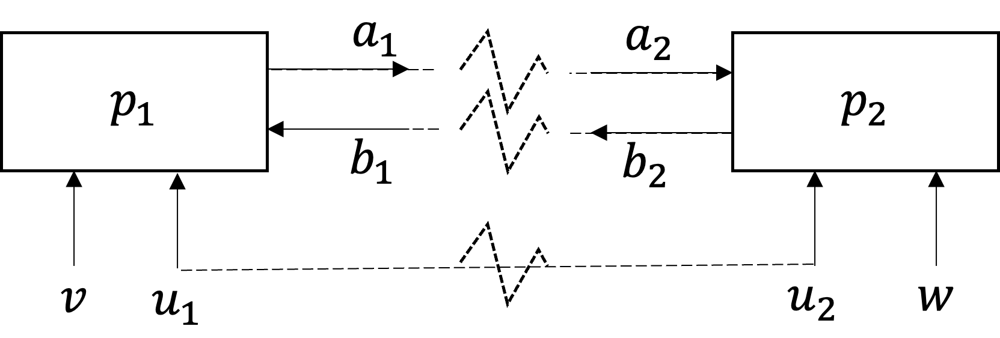

Getting started
===============

Installation
------------

DMDO needs Python 3.10 or newer.

From the Python Package Index:

.. code-block:: console

   $ pip install DMDO

To install from source and run the test suite:

.. code-block:: console

   $ git clone https://github.com/Ahmed-Bayoumy/DMDO.git
   $ cd DMDO
   $ pip install -e .
   $ pytest tests

DMDO uses `OMADS <https://github.com/Ahmed-Bayoumy/OMADS>`_ :cite:p:`OMADS_AB` for its derivative-free subproblem
solvers and SciPy for the gradient-based ones, together with ``numpy``, ``pandas`` and ``pyyaml``. Installing DMDO
also installs the ``dmdo`` command of the optional HTTP service (:doc:`tutorials/service`).

A first problem
---------------

The example below is the basic two-discipline problem :eq:`eq-basic` used throughout this documentation. Its two
analyses are coupled in both directions: :math:`a` depends on :math:`b`, and :math:`b` depends on :math:`a`.

.. math::
   :label: eq-basic

   \begin{array}{ll}
   \min_{u,v,w} & u + v + a + b \\[2pt]
   \text{s.t.}  & a = \log_{10} u + \log_{10} v + \log_{10} b, \\
                & b = u^{-1} + w^{-1} + a^{-1}, \\
                & w + b - 10 \le 0, \qquad 0 \le u, v, w, a, b \le 10.
   \end{array}

.. _fig-basic-partitioned:

   The basic problem partitioned into two subproblems. Each keeps its own copies of the shared variable :math:`u`
   and of the coupling variables :math:`a` and :math:`b`.

DMDO solves it as two subproblems. Subproblem 1 owns :math:`v` and computes :math:`a`; subproblem 2 owns :math:`w`,
computes :math:`b` and holds the constraint. Each one keeps a copy of :math:`u`, :math:`a` and :math:`b`, and the
coordinator drives the copies to agreement (see :doc:`background`).

A run takes three steps:

#. write the **analyses** (one per discipline) and the **subproblem objectives** as Python callables;
#. describe the problem in a YAML file (or a dictionary): variables, analyses, subproblems and coordinator;
#. build a :class:`~DMDO.Session` and run it.

.. code-block:: python
   :caption: first_run.py

   import numpy as np
   from DMDO import Session

   def A1(x):                       # x = [u, v, b]  ->  [a]
       x = np.maximum(x, 1e-12)
       return [np.log10(x[0]) + np.log10(x[1]) + np.log10(x[2])]

   def A2(x):                       # x = [u, w, a]  ->  [b]
       x = np.maximum(x, 1e-12)
       return [1 / x[0] + 1 / x[1] + 1 / x[2]]

   def opt1(x, y, c=None):          # x = [u, v, b], y = [a]
       return [sum(x) + y[0], [0.0]]

   def opt2(x, y, c=None):          # x = [u, w, a], y = [b]
       return [0.0, [x[1] + y[0] - 10.0]]

   if __name__ == "__main__":
       session = Session.from_yaml("basic_problem.yaml", working_dir="runs",
                                   blackboxes={"A1": A1, "A2": A2, "opt1": opt1, "opt2": opt2})
       result = session.run()
       print(result.status, result.stop_reason)
       print("objective:", result.objective, "max. inconsistency:", result.max_inconsistency)
       print(result.variables)

``result`` is a :class:`~DMDO.RunResult`: the final status and stopping reason, the objective of the master
subproblem, the maximum inconsistency between copies, every variable copy and the per-iteration history.
``result.to_dict()`` gives the same content as plain JSON-ready values.

.. important::

   Guard the call with ``if __name__ == "__main__":`` in scripts. Parallel runs use :mod:`multiprocessing`, and on
   Windows and macOS worker processes re-import your script.

The problem definition
----------------------

``basic_problem.yaml`` (shipped in the ``examples`` folder of the repository) describes the variables, the analyses,
how analyses are grouped per subproblem, the coordinator and the subproblems:

.. literalinclude:: ../examples/basic_problem.yaml
   :language: yaml
   :caption: examples/basic_problem.yaml

``variables``
   One row per variable **copy**: ``[name, subproblem, linked subproblem, coupling, lb, baseline, ub, dim, type]``.
   ``u`` appears twice, once in each subproblem, linked to the other one; ``v`` and ``w`` are local (``u``,
   uncoupled). The coupling codes are ``s`` (shared variable), ``ff``/``fb`` (feed-forward and feedback coupling
   variables), ``u`` (local) and ``CP`` (constant parameter).
``DA``
   The disciplinary analyses: which variables they read, which they compute, and the name of the callable that does
   it (``blackbox``).
``MDA``
   The analyses evaluated inside each subproblem and the variables they exchange with it.
``coord``
   The coordinator: penalty growth factor ``beta``, number of subproblems, outer-iteration ``budget``, the master
   subproblem (the one that holds the system objective) and the penalty-weight update scheme.
``subproblem``
   Each subproblem's design variables (``vars``), responses (``resps``), objective callable (``opt``), inner solver
   and inner evaluation budget.
``MDO``
   The overall run: coordinator, subproblems, stopping tolerance ``inc_stop`` on the inconsistency and console
   output.

:doc:`user_guide/problem_definition` lists every key and its default.

The analysis and objective contract
-----------------------------------

**Analyses** receive their inputs as a list ordered like the ``inputs`` of their ``DA`` entry and return a list of
outputs ordered like its ``outputs``. An analysis may also be any object with a ``compute(inputs) -> outputs``
method working on dictionaries keyed by variable name (a :class:`~DMDO.Discipline`), which is the natural way to
wrap a simulation or a model from another framework:

.. code-block:: python

   class A1:
       def compute(self, inputs):          # inputs = {"u": ..., "v": ..., "b": ...}
           return {"a": np.log10(inputs["u"]) + np.log10(inputs["v"]) + np.log10(inputs["b"])}

**Subproblem objectives** receive the subproblem's design vector ``x`` (ordered like ``vars``), the responses ``y``
of its analyses (ordered like ``resps``) and, optionally, constant parameters ``c``. They return
``[f, [g1, g2, ...]]``: the local objective and the local constraints in the form :math:`g_i \le 0`. Subproblems
without a local objective return ``0``; subproblems without constraints return ``[0]``.

Callables are referenced by name in the problem definition. Names are resolved from the ``blackboxes`` mapping
given to the session, then from the global registry (:func:`DMDO.register_blackbox`), then as an import path such as
``"my_package.aero:lift"``.

Where to go next
----------------

* :doc:`tutorials/basic` runs this problem step by step and explains its output files.
* :doc:`tutorials/sellar` solves the Sellar problem with three different inner solvers.
* :doc:`tutorials/session` drives a run one iteration at a time and solves the subproblems from outside.
* :doc:`background` explains the formulation the coordinator solves.
