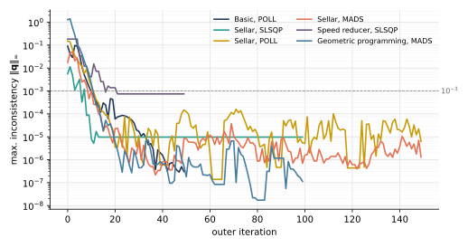

DMDO: Distributed Multidisciplinary Design Optimization
=======================================================

| **Author:** Ahmed H. Bayoumy
| **Release:** |release|
| **Source:** https://github.com/Ahmed-Bayoumy/DMDO

.. rst-class:: dmdo-tagline

   **Design the whole system, let every discipline keep its own tools.** DMDO decomposes a coupled
   multidisciplinary design problem into subproblems, solves each one with the optimizer that suits it, and
   coordinates them until the disciplines agree on one consistent, optimal design.

Why DMDO
--------

Aircraft, vehicles, turbines and energy systems are designed by teams that each own an analysis: aerodynamics,
structures, propulsion, controls, cost. Optimizing them as one monolithic problem requires a multidisciplinary
analysis (MDA) that converges at every design point, a single optimizer that suits every discipline, and every code
in one process. DMDO removes those three requirements.

* **No converged MDA needed.** DMDO implements nonhierarchical analytical target cascading (NHATC)
  :cite:p:`tosserams2010nonhierarchical`: each subproblem keeps local copies of the variables it shares with others,
  and an augmented Lagrangian coordinator drives the copies to agreement. Coupled analyses never have to be iterated
  to convergence inside the optimizer.
* **The right optimizer for each discipline.** A subproblem built on a noisy simulation can use derivative-free Mesh
  Adaptive Direct Search (OMADS :cite:p:`OMADS_AB,audet2006mesh`), while a smooth analytical one uses SciPy's SLSQP,
  in the same run. Any other optimizer plugs in through a five-line strategy class.
* **Measured on the classic MDO benchmarks.** On the Sellar problem :cite:p:`sellar1996response` with MADS
  subproblems, DMDO reaches :math:`f = 3.2042`, **0.65 % from the known optimum** :math:`f^\ast = 3.18339`, with the
  disciplines consistent to :math:`1.3\times10^{-6}`. Across the six recorded regression runs (Sellar, Golinski's
  speed reducer, a geometric program and a basic two-discipline problem), the maximum inconsistency between
  disciplines falls **below** :math:`10^{-3}` **within 6 to 16 outer iterations**; see :doc:`benchmarking`.
* **Serial, parallel or distributed, with the same answer.** Subproblems can be swept one after the other
  (Gauss–Seidel) or all at once (Jacobi) in-process, in a pool of worker processes, or on remote machines. Jacobi
  results are merged in subproblem order, so they do not depend on which worker finishes first.
* **An API, not just a script.** Build a problem from YAML, a dictionary or Python objects, then drive it with
  ``run()``, one outer iteration at a time with ``step()``, or solve the subproblems yourself with
  ``ask()``/``tell()``. Observers stream progress, registries and entry points add solvers, executors and analyses,
  and an optional HTTP service exposes sessions to any language.
* **Results you can reproduce.** Runs are seeded, every regression problem is checked against a recorded history
  that the current code must reproduce bit for bit, runs can be checkpointed and resumed exactly, and the test suite
  runs on Linux, Windows and macOS.

   Maximum inconsistency between disciplines at each outer iteration of the six recorded regression runs.

Main features
-------------

.. grid:: 1 2 2 3
   :gutter: 3

   .. grid-item-card:: NHATC coordination
      :link: background
      :link-type: doc

      Nonhierarchical target cascading with an augmented Lagrangian penalty and method-of-multipliers updates;
      penalty weights grow only on couplings that stall.

   .. grid-item-card:: Pluggable subproblem solvers
      :link: tutorials/extending
      :link-type: doc

      ``mads``, ``poll`` and ``search`` from OMADS, ``scipy`` (SLSQP, COBYLA, ...), or your own
      :class:`~DMDO.BaseSolver` registered by name or entry point.

   .. grid-item-card:: Gauss–Seidel and Jacobi sweeps
      :link: tutorials/parallel
      :link-type: doc

      Sequential sweeps that use the latest targets, or parallel sweeps whose results are independent of the
      execution order.

   .. grid-item-card:: Session API
      :link: tutorials/session
      :link-type: doc

      ``run``, ``step``, ``ask``/``tell``, early stopping, JSON-ready results, checkpoints and exact resume.

   .. grid-item-card:: Observers and plugins
      :link: implementation
      :link-type: doc

      Hooks on every phase of the coordination loop; registries for solvers, executors, analyses and coordination
      policies.

   .. grid-item-card:: HTTP service and remote workers
      :link: tutorials/service
      :link-type: doc

      ``dmdo serve`` and ``dmdo worker``: drive sessions over HTTP and pin subproblems to the machines that hold
      their analysis codes. Standard library only.

Minimal example
---------------

The problem is described in a YAML file (variables, analyses, subproblems, coordinator); the analyses and
objectives are ordinary Python callables, given by name.

.. code-block:: python

   import numpy as np
   from DMDO import Session

   def A1(x):                       # analysis of discipline 1: a = log10(u) + log10(v) + log10(b)
       x = np.maximum(x, 1e-12)
       return [np.log10(x[0]) + np.log10(x[1]) + np.log10(x[2])]

   def A2(x):                       # analysis of discipline 2: b = 1/u + 1/w + 1/a
       x = np.maximum(x, 1e-12)
       return [1 / x[0] + 1 / x[1] + 1 / x[2]]

   def opt1(x, y, c=None):          # subproblem 1: objective u + v + b + a, no constraint
       return [sum(x) + y[0], [0.0]]

   def opt2(x, y, c=None):          # subproblem 2: no objective, constraint w + b - 10 <= 0
       return [0.0, [x[1] + y[0] - 10.0]]

   if __name__ == "__main__":
       session = Session.from_yaml("basic_problem.yaml", working_dir="runs",
                                   blackboxes={"A1": A1, "A2": A2, "opt1": opt1, "opt2": opt2})
       result = session.run()
       print(result.status, result.iterations, result.objective, result.max_inconsistency)
       print(result.variables)      # final copies of every variable, e.g. {"u_1": ..., "u_2": ...}

:doc:`getting_started` walks through this problem and its YAML file line by line.

Organization of this documentation
----------------------------------

:doc:`getting_started`
   Installation, a first run, the structure of a problem definition and the contract of analyses and objectives.
:doc:`background`
   Decomposition-based MDO, analytical target cascading, the NHATC formulation and the augmented Lagrangian
   coordinator, with the algorithms given as pseudocode.
:doc:`implementation`
   How DMDO is built: the package layers, its interfaces, the coordination loop, executors, observers, sessions and
   the service layer.
:doc:`benchmarking`
   The regression problems and the recorded results on Sellar, the speed reducer and the geometric program.
:doc:`tutorials/index`
   Worked examples: the basic problem, Sellar with three inner solvers, parallel and remote execution, the Session
   API, extension points and the HTTP service.
:doc:`user_guide/problem_definition` and :doc:`user_guide/outputs`
   Complete description of the problem-definition keys and of the files a run produces.
:doc:`api/index`
   Reference of the public classes and functions.

Citation
--------

If DMDO contributes to published work, please cite it as follows.

.. code-block:: bibtex

   @software{DMDO_AB,
     author    = {Bayoumy, Ahmed H.},
     title     = {DMDO: Distributed Multidisciplinary Design Optimization},
     year      = {2022},
     publisher = {GitHub},
     version   = {2612.0},
     url       = {https://github.com/Ahmed-Bayoumy/DMDO}
   }

License
-------

© Ahmed H. Bayoumy 2022–2026. DMDO is free software distributed under the GNU General Public License, version 3 or
later; see the `LICENSE <https://github.com/Ahmed-Bayoumy/DMDO/blob/DEV/LICENSE>`_ file.

.. toctree::
   :hidden:
   :caption: Getting started

   getting_started

.. toctree::
   :hidden:
   :caption: Technical Documentation

   background
   implementation
   benchmarking

.. toctree::
   :hidden:
   :caption: Demo Documentation

   tutorials/index

.. toctree::
   :hidden:
   :caption: User guide

   user_guide/problem_definition
   user_guide/outputs

.. toctree::
   :hidden:
   :caption: Code Documentation

   api/index
   references
