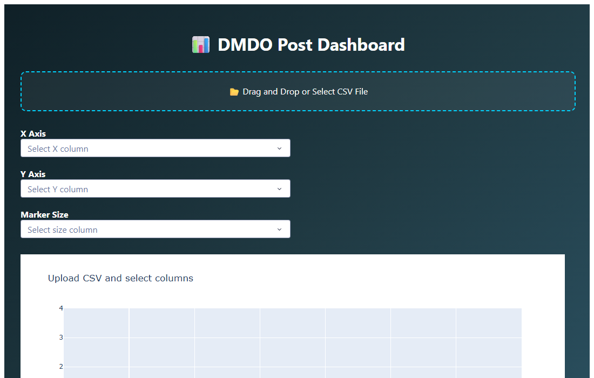
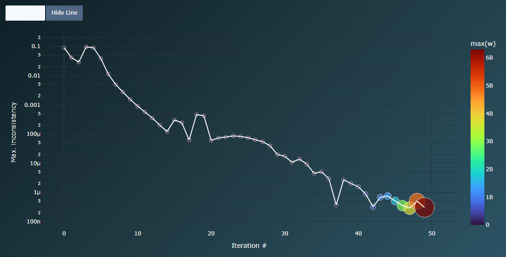

The post-processing dashboard
#############################

DMDO ships a small web dashboard for exploring the files a run writes. It plots any column of a run's history
against any other, so the progress of the coordination (consistency, objective, penalty weights, variable copies)
or of a single subproblem's inner solves can be inspected interactively, without writing plotting code.

Starting the dashboard
======================

.. code-block:: python

   from DMDO import dmdo_dash

   dmdo_dash()          # serves the dashboard on http://127.0.0.1:8050

or, from a terminal:

.. code-block:: console

   $ python -m DMDO.dashboard

Then open http://127.0.0.1:8050 in a browser. The dashboard runs on Dash's development server, on your own machine
only; stop it with :kbd:`Ctrl+C`.

   The dashboard before a file is loaded.

Plotting a run
==============

#. **Load a file.** Drop a file on the dashed area, or click it to pick one. Any comma-separated output of a run
   can be loaded: the coordination history ``Coordination_history.out``, or the evaluation history
   ``SP_<j>_<t>.out`` of one subproblem solve (:doc:`../user_guide/outputs`). The ``.out`` files are plain CSV;
   select *All files* in the file picker if it only lists ``.csv`` files.
#. **Choose the axes.** The *X Axis* and *Y Axis* selectors list every column of the file. They start on the first
   two columns (``Time`` and ``Iteration #``); pick, for example, ``Iteration #`` and ``Max. inconsistency``.
#. **Optionally choose a marker-size column.** The marker size, and the color, then grow with that column, e.g.
   ``max(w)`` to see where the penalty weights grow. Without one, the markers are colored by the Y values.

   The basic problem of :doc:`basic`: maximum inconsistency (Y) at each outer iteration (X), with markers sized and
   colored by the largest penalty weight ``max(w)``. The copies agree to :math:`3\times10^{-7}` while the
   penalty weights reach about :math:`6\times10^{9}`.

The plot is interactive: hover over a point to read its values, drag to zoom, double-click to reset the view, and
use the toolbar to pan or save the figure as a PNG. The *Show Line* and *Hide Line* buttons toggle the line that
joins the points in X order.

.. note::

   The Y axis is logarithmic, which suits inconsistencies, penalty weights and constraint violations spanning many
   orders of magnitude. Zero and negative values cannot be shown on it, so columns that change sign (for example an
   objective that becomes negative) are only partly displayed.

Useful views
============

.. list-table::
   :header-rows: 1
   :widths: 26 26 20 28

   * - File
     - X axis
     - Y axis
     - Marker size
   * - ``Coordination_history.out``
     - ``Iteration #``
     - ``Max. inconsistency``
     - ``max(w)``
   * - ``Coordination_history.out``
     - ``Iteration #``
     - ``Objective``
     - ``Max. inconsistency``
   * - ``Coordination_history.out``
     - ``Iteration #``
     - ``Variables change``
     - ``Max. inconsistency``
   * - ``SP_<j>_<t>.out``
     - ``Evaluation #``
     - ``Penalty``
     - ``Max. inconsistency``

For plots in scripts or reports, load the same files with :mod:`pandas` (:doc:`basic` shows how).
