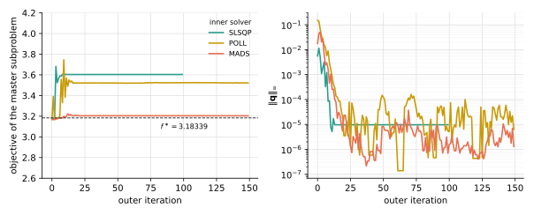

The Sellar problem
##################

The Sellar problem :cite:p:`sellar1996response` is the classic two-discipline test of MDO architectures. Its optimum
is known, :math:`f^\ast = 3.18339`, which makes it a direct measure of how well a coordination method works. This
tutorial builds it with DMDO's Python API (the same objects the YAML builder creates) and compares three inner
solvers.

The problem
===========

.. math::

   \begin{array}{ll}
   \min_{x, z_1, z_2} & x^2 + z_2 + y_1 + e^{-y_2} \\[2pt]
   \text{s.t.} & 3.16 - y_1 \le 0, \qquad y_2 - 24 \le 0, \\[2pt]
   \text{with} & y_1 = z_1^2 + x + z_2 - 0.2\,y_2, \qquad y_2 = \sqrt{y_1} + z_1 + z_2, \\[2pt]
               & 0 \le x \le 10,\quad -10 \le z_1 \le 10,\quad 0 \le z_2 \le 10.
   \end{array}

.. grid:: 1 2 2 2
   :gutter: 2

   .. grid-item::

      .. figure:: ../media/figures/Sellar_Wflow.png
         :width: 95%
         :align: center

         Data flow between the two disciplines.

   .. grid-item::

      .. figure:: ../media/figures/sellar_xdsm.png
         :width: 100%
         :align: center

         The Sellar problem partitioned into two subproblems.

The two analyses form a loop: :math:`y_1` depends on :math:`y_2` and :math:`y_2` on :math:`y_1`, and both depend on
the shared variables :math:`z_1, z_2`. DMDO splits the problem into two subproblems that each keep a copy of
:math:`z_1`, :math:`z_2`, :math:`y_1` and :math:`y_2`:

.. math::

   (p_1)\quad
   \begin{array}{ll}
   \min_{x, z_{1,1}, z_{2,1}, y_{2,1}} & x^2 + z_{2,1} + y_{1,1} + e^{-y_{2,1}}
       + \phi_{z_1} + \phi_{z_2} + \phi_{y_1} + \phi_{y_2} \\[2pt]
   \text{s.t.} & 3.16 - y_{1,1} \le 0, \qquad y_{1,1} = x + z_{1,1}^2 + z_{2,1} - 0.2\, y_{2,1},
   \end{array}

.. math::

   (p_2)\quad
   \begin{array}{ll}
   \min_{z_{1,2}, z_{2,2}, y_{1,2}} & \phi_{z_1} + \phi_{z_2} + \phi_{y_1} + \phi_{y_2} \\[2pt]
   \text{s.t.} & y_{2,2} - 24 \le 0, \qquad y_{2,2} = \sqrt{y_{1,2}} + z_{1,2} + z_{2,2},
   \end{array}

where :math:`\phi_{z_1} = \phi(z_{1,1} - z_{1,2})` and so on (:eq:`eq-phi` in :doc:`../background`). Subproblem 1
holds the objective, so it is the master subproblem.

The analyses and objectives
===========================

Analyses take their inputs as a list and return a list of outputs; objectives take the subproblem's design vector
``x`` and analysis outputs ``y`` and return ``[f, [g1, ...]]`` with constraints :math:`g \le 0`.

.. literalinclude:: ../../tests/test_basic.py
   :language: python
   :pyobject: Sellar_A1

.. literalinclude:: ../../tests/test_basic.py
   :language: python
   :pyobject: Sellar_A2

.. literalinclude:: ../../tests/test_basic.py
   :language: python
   :pyobject: Sellar_opt1

.. literalinclude:: ../../tests/test_basic.py
   :language: python
   :pyobject: Sellar_opt2

Building the problem with the Python API
========================================

The Python API mirrors the sections of a YAML definition:

#. one :class:`~DMDO.variableData` per variable copy (name, subproblem, link, coupling type, bounds, baseline);
#. one :class:`~DMDO.DA` per analysis and one :class:`~DMDO.MDA` per subproblem, listing the variables they read
   and the responses they compute;
#. the :class:`~DMDO.ADMM` coordinator (penalty growth :math:`\beta`, stall threshold :math:`\gamma`, update scheme,
   outer budget);
#. one :class:`~DMDO.SubProblem` per subproblem, with its variables, responses, objective and inner solver;
#. the :class:`~DMDO.MDO` process that ties them together and runs the coordination.

The complete setup used by the regression suite, with SciPy's SLSQP as the inner solver:

.. dropdown:: ``Sellar_scipy()`` from ``tests/test_basic.py``
   :open:

   .. literalinclude:: ../../tests/test_basic.py
      :language: python
      :pyobject: Sellar_scipy

``scipy={"method": "SLSQP", ..., "is_con": True}`` passes the subproblem constraints to SLSQP as inequality
constraints. Replacing ``solver="scipy"`` by ``solver="poll"`` or ``solver="mads"`` (and the ``scipy`` block by an
OMADS configuration, ``conf=``) switches the subproblems to the derivative-free OMADS solvers; ``Sellar_OMADS_POLL``
and ``Sellar_OMADS_MADS`` in the same file show the complete setups.

Running the same problem through a :class:`~DMDO.Session` instead of ``MDAO.run`` gives step-by-step control and a
:class:`~DMDO.RunResult`:

.. code-block:: python

   from DMDO import Session

   session = Session(MDAO)            # MDAO: the MDO object built above
   result = session.run()
   print(result.objective, result.max_inconsistency)

Results with three inner solvers
================================

The regression suite records the complete history of the three variants (see :doc:`../benchmarking`):

.. list-table::
   :header-rows: 1
   :widths: 28 14 18 14 26

   * - Inner solver
     - Outer iterations
     - Final objective
     - Gap to :math:`f^\ast`
     - Final max. inconsistency
   * - SciPy SLSQP
     - 100
     - 3.60373
     - +13.20 %
     - :math:`9.7\times10^{-6}`
   * - OMADS ``poll``
     - 150
     - 3.52160
     - +10.62 %
     - :math:`6.2\times10^{-6}`
   * - OMADS ``mads``
     - 150
     - 3.20420
     - **+0.65 %**
     - :math:`1.3\times10^{-6}`

   Objective of the master subproblem (left) and maximum inconsistency (right) with the three inner solvers.

All three variants reach consistency to better than :math:`10^{-5}`, but only the full MADS algorithm, whose search
step explores the subproblem design space globally, ends close to the optimum. The gradient-based SLSQP subproblems
lock in a consistent design within a few outer iterations, before the coordination has found the best one. The
inner solver is therefore a modeling choice of its own: DMDO lets every subproblem use a different one.
